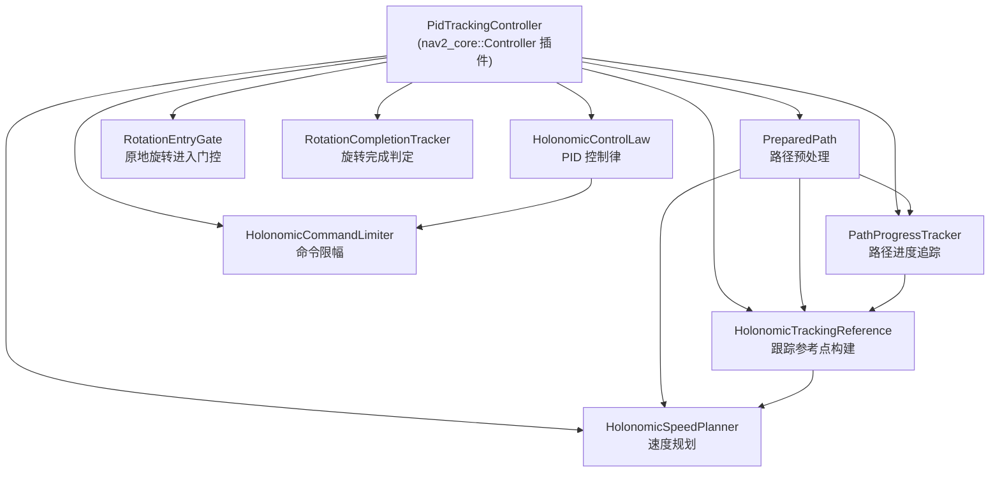

# pid_tracking_controller 全面分析报告

## 一、包概览

| 指标 | 数据 |
|------|------|
| 定位 | Nav2 controller 插件，用于四轮全向 (holonomic) 机器人路径追踪 |
| 版本 | 0.1.0 |
| 语言标准 | C++17 |
| 源码行数 | 3,199 行 (9 .cpp + 8 .hpp) |
| 测试行数 | 3,972 行 (11 test + 1 helper header) |
| ROS 发行版 | Jazzy (nav2_core 接口) |
| 控制频率 | 默认 15 Hz |

---

## 二、架构分析

### 模块拓扑



### 模块职责详解

| 模块 | 文件 | 行数 | 职责 |
|------|------|------|------|
| **PreparedPath** | [prepared_path.cpp](file:///home/CNF2026987648/s100_docker/src/pid_tracking_controller/src/prepared_path.cpp) | 148 | 将 nav_msgs/Path 解析为 translation/rotation 分段序列，计算弧长、切线方向和 yaw 变化率 |
| **PathProgressTracker** | [path_progress_tracker.cpp](file:///home/CNF2026987648/s100_docker/src/pid_tracking_controller/src/path_progress_tracker.cpp) | 511 | 投影机器人位置到路径上，管理沿弧长方向的单调前进（含 budget 防跳跃），输出 carrot 点和曲率 |
| **HolonomicTrackingReference** | [holonomic_tracking_reference.cpp](file:///home/CNF2026987648/s100_docker/src/pid_tracking_controller/src/holonomic_tracking_reference.cpp) | 381 | 从 progress + lookahead 构建跟踪参考状态：translation/rotation_pending/terminal 三种模式 |
| **HolonomicSpeedPlanner** | [holonomic_speed_planner.cpp](file:///home/CNF2026987648/s100_docker/src/pid_tracking_controller/src/holonomic_speed_planner.cpp) | 509 | 多约束速度规划：body axis limit、yaw rate limit、tangent rate limit、stopping distance limit、external limit |
| **HolonomicControlLaw** | [holonomic_control_law.cpp](file:///home/CNF2026987648/s100_docker/src/pid_tracking_controller/src/holonomic_control_law.cpp) | 98 | 纯 P 控制律：body-frame 位置反馈 + 前馈速度 + yaw P 控制 |
| **HolonomicCommandLimiter** | [holonomic_command_limiter.cpp](file:///home/CNF2026987648/s100_docker/src/pid_tracking_controller/src/holonomic_command_limiter.cpp) | 291 | 速度/加速度限幅，非对称制动限制，external speed limit 投影 |
| **RotationEntryGate** | [rotation_entry_gate.cpp](file:///home/CNF2026987648/s100_docker/src/pid_tracking_controller/src/rotation_entry_gate.cpp) | 90 | 原地旋转前的 stop-and-confirm 门控 |
| **RotationCompletionTracker** | [rotation_completion_tracker.cpp](file:///home/CNF2026987648/s100_docker/src/pid_tracking_controller/src/rotation_completion_tracker.cpp) | 82 | 检测旋转是否完成 (yaw + ω + xy speed 都在容差内，并 settle 一段时间) |

---

## 三、控制流水线详解

每个控制周期 (`computeVelocityCommands`) 的完整流水线：

```
1. 输入验证 (pose / velocity / quaternion / path)
2. TF 变换到路径坐标系
3. Lookahead 距离计算：L = clamp(|v| × t_lookahead, L_min, L_max)
4. PathProgressTracker::update → 投影 + carrot + progress 推进
5. buildHolonomicTrackingReference → 判断模式 + 构建参考
6. HolonomicSpeedPlanner::plan → 多约束参考速度
7. computeHolonomicRawCommand → P 控制律 (FF + FB)
8. HolonomicCommandLimiter::limit → 限幅 + slew rate
9. RotationEntryGate / RotationCompletionTracker → 旋转状态机
10. 发布 carrot 点 + 输出 TwistStamped
```

### 控制律核心公式 ([holonomic_control_law.cpp:53-94](file:///home/CNF2026987648/s100_docker/src/pid_tracking_controller/src/holonomic_control_law.cpp#L53-L94))

```
# 世界坐标系误差
e_x_world = ref_x - robot_x
e_y_world = ref_y - robot_y

# 转换到 body frame
e_x_body = cos(θ)·e_x_world + sin(θ)·e_y_world
e_y_body = -sin(θ)·e_x_world + cos(θ)·e_y_world

# 前馈速度 (世界→body)
vx_ff = v_ref · cos(tangent - θ)
vy_ff = v_ref · sin(tangent - θ)    (省略了中间世界坐标步骤)

# 反馈
vx_fb = kp_x · e_x_body
vy_fb = kp_y · e_y_body

# yaw
yaw_error = normalize(target_yaw - θ)
ω_ff = yaw_rate_per_meter · v_ref
ω_fb = kp_yaw · yaw_error

# 最终指令
vx = vx_ff + vx_fb
vy = vy_ff + vy_fb
ω  = ω_ff + ω_fb
```

---

## 四、优点总结

### ✅ 1. 清晰的模块化架构
每个子功能 (路径预处理、进度追踪、速度规划、控制律、限幅、旋转管理) 各自独立为一个类，职责单一，可独立测试。

### ✅ 2. 极其丰富的单元测试
- 测试代码行数 (3,972) 多于源码 (3,199)，**测试/源码比 1.24**
- 覆盖所有 8 个模块 + 集成测试 (`test_path_and_control`)  + 生命周期冒烟测试 (`test_lifecycle_smoke`)
- 测试用例涵盖边界条件、异常输入、数值精度

### ✅ 3. 极度防御性的数值安全
- 每个入口都有 `isFinite()` / `isValid()` 校验
- 输出前再次校验有限性
- `long double` 中间运算防止浮点精度丢失 (limiter 中)
- `quantizeTowardPrevious` 确保浮点舍入安全
- `nextafter` 保证速度投影后满足限制

### ✅ 4. 完善的速度规划子系统
- 多约束级联限速：nominal → external → body axis → combined speed → yaw rate → tangent rate → stopping distance
- 停车规划考虑了控制延迟 (`stopping_delay`)
- 前瞻性速度限制可以从未来约束点反向传播 (`propagatedSpeed`)
- 独立的参考速度升/降加速度 (`a_ref_up` / `a_ref_down`)

### ✅ 5. 完善的旋转处理
- Stop-before-rotate 门控：先制动停稳，确认停稳后再开始旋转
- 旋转完成需要 yaw / ω / xy_speed 同时在容差内并 settle 一段时间
- 连续旋转段 (同一位置多次旋转) 会合并为最终目标 yaw
- 制动超时保护 (8s timeout → `NoValidControl`)

### ✅ 6. 丰富的诊断日志
- `PID_LOG` 前缀结构化日志，包含 mode、plan_revision、所有速度值、限速原因等
- 节流输出 (1s 间隔) + 状态变更时强制输出
- 便于线上调试和问题定位

### ✅ 7. 良好的工程实践
- 完全符合 Nav2 插件接口 (`nav2_core::Controller`)
- 所有异常正确分类 (`InvalidPath` / `ControllerTFError` / `NoValidControl`)
- 支持 `setSpeedLimit` 外部限速接口
- 参数全部声明式配置，有合理默认值

---

## 五、缺点与不足（按优先级排列）

### P0 — 直接影响追踪精度

#### 🔴 1. 仅有 P 控制 — 名不副实的 "PID"

> [!CAUTION]
> 包名叫 "pid_tracking_controller"，但控制律中 **只有比例 (P) 项，没有积分 (I) 和微分 (D)**。

```cpp
// holonomic_control_law.cpp:79-85
command.vx_fb = gains.kp_x * command.ex_body;   // 纯 P
command.vy_fb = gains.kp_y * command.ey_body;   // 纯 P
command.omega_fb = gains.kp_yaw * command.yaw_error;  // 纯 P
```

**影响**：
- **无积分项**：存在稳态误差。当有外部干扰 (地面摩擦力差异、负载不均) 时，机器人会持续偏离路径而无法自动修正
- **无微分项**：缺乏阻尼能力。在接近目标点或急弯处可能出现振荡；kp 调高后容易过冲来回摆

**实际危害**：对于工业/商用清洁机器人，地面材质变化 (瓷砖→地毯) 会产生持续的侧向力扰动，纯 P 控制器产生持续的横向偏差。

---

#### 🔴 2. 没有前瞻曲率适应 — 弯道必然切角或过冲

控制律仅看 **当前参考点** 的切线方向，没有利用曲率信息来预调转向。

```cpp
// holonomic_control_law.cpp:74-77  — 前馈仅用 path_tangent
command.vx_ff = cosine * vx_ff_world + sine * vy_ff_world;
command.vy_ff = -sine * vx_ff_world + cosine * vy_ff_world;
```

> [!WARNING]
> `PathProgressTracker` 已经计算了 `curvature`（通过三点圆弧拟合），但**这个值在整个控制链中完全没有被使用**。

**影响**：
- 高速过弯时，控制指令滞后于路径弯曲，产生明显的 **切角 (corner-cutting)**
- 需要靠反馈误差 (P 项) 才能逐步修正，但这是被动的、滞后的
- S 弯或连续变曲率路径中效果尤差

---

#### 🔴 3. Lookahead 距离策略过于简单

```cpp
// pid_tracking_controller.cpp:377-382
double PidTrackingController::getLookAheadDistance(double vt) {
    double lookahead_dist = fabs(vt) * lookahead_time_;
    return std::clamp(lookahead_dist, min_lookahead_dist_, max_lookahead_dist_);
}
```

问题：
- **仅基于当前速度的标量值**，不考虑路径曲率
- 弯道中使用与直道相同的 lookahead，参考点可能跳到弯后的直线段，导致 **切角**
- 缺乏类似 Pure Pursuit 或 MPC 中的自适应前瞻距离策略

> [!NOTE]
> 第 2、3 条问题紧密关联：如果 lookahead 能根据曲率自适应缩短，即使没有曲率前馈，弯道切角也能大幅缓解。

---

### P1 — 影响运行效率和性能上限

#### 🟠 4. 旋转-平移切换的 stop-and-go 策略效率低

路径中每遇到一个 rotation segment，控制器必须：
1. 减速到停 (stopping_deceleration 保守值 0.12 m/s²)
2. 等待制动确认 (stop_confirm_time = 0.2s)
3. 等待旋转完成 + settle_time (0.3s)
4. 再加速到巡航

> [!IMPORTANT]
> 全向机器人理论上可以边走边转（translation + rotation 同时进行），但当前实现将它们**严格串行化**。每个旋转段至少浪费 ~1-2 秒的完全停顿时间。

如果路径有大量拐角，总行走时间会显著增加。例如 10 个弯道，仅停顿就增加 10-20 秒。

---

#### 🟠 5. 缺少对运动学/动力学模型的利用

控制律是纯运动学的 (直接输出 vx/vy/ω body-frame 速度)，没有：
- 四轮全向底盘的运动学模型 (正/逆运动学)
- 轮子速度限制的考虑 (单轮饱和时 body 速度实际不可达)
- 执行器响应模型 (电机延迟、响应带宽)

> [!NOTE]
> 速度/加速度限幅器 (`HolonomicCommandLimiter`) 只做了独立的 vx/vy/ω 裁剪，但四轮全向机器人的可行速度空间不是简单的矩形 (vx, vy 各自独立)，而是取决于轮子布局的多面体约束。

---

#### 🟠 6. 停车距离规划的保守与脆弱并存

停车规划 ([holonomic_speed_planner.cpp:456-470](file:///home/CNF2026987648/s100_docker/src/pid_tracking_controller/src/holonomic_speed_planner.cpp#L456-L470))：

```cpp
stopping_delay_distance = max(observed_speed, previous_ref_v) * stopping_delay;
stopping_distance = max(0, horizon_arc - current_arc - stopping_delay_distance);
stopping_speed_limit = sqrt(2 * stopping_decel * stopping_distance);
stopping_speed_limit = max(stopping_speed_limit, stopping_min_speed);  // 若 distance>0
```

- `stopping_delay` (0.5s) 包含了位姿延迟、控制周期、驱动响应——这是一个粗糙的线性估计
- `stopping_deceleration` (0.12 m/s²) 远小于 `max_decel_x/y` (0.60 m/s²)，过于保守
- 如果 `stopping_delay_distance` 超过了实际剩余距离，机器人会以 `stopping_min_speed` (0.02 m/s) 爬行，但如果延迟估计不准确，可能越过旋转边界

---

### P2 — Nav2 集成规范性

#### 🟡 7. 没有利用 GoalChecker

```cpp
// pid_tracking_controller.cpp:522-525
geometry_msgs::msg::TwistStamped PidTrackingController::computeVelocityCommands(
  const geometry_msgs::msg::PoseStamped & pose,
  const geometry_msgs::msg::Twist & velocity,
  nav2_core::GoalChecker * /*goal_checker*/)   // ← 完全忽略
```

`goal_checker` 被注释掉了。终点到达判定完全依赖自身的 terminal mode + path end 判定，与 Nav2 的 GoalChecker 机制脱节。

---

#### 🟡 8. Costmap 被接收但完全未使用

```cpp
// 构造时接收 costmap_ros
costmap_ros_ = std::move(costmap_ros);
costmap_ = costmap_ros_->getCostmap();
```

但在整个控制循环中，`costmap_` **从未被读取**。这不仅浪费了资源（持有 costmap 引用），也意味着控制器对障碍物完全盲目。

> [!NOTE]
> 目前不考虑避障，但代码中持有 costmap 却不用，暗示设计时可能计划使用但未实现。

---

#### 🟡 9. 参数不支持动态重配

所有参数在 `configure()` 时读取一次并存入成员变量。控制器运行期间修改参数 (如通过 `ros2 param set`) **不会生效**，除非重新 configure。

这对调参不友好——需要重启导航栈才能尝试不同的增益值。

---

## 六、缺点优先级总览

| 优先级 | 编号 | 问题 | 影响维度 |
|:---:|:---:|------|------|
| **P0** | 1 | 仅 P 控制，无 I/D | 稳态精度、阻尼 |
| **P0** | 2 | 未利用已有曲率信息 | 弯道追踪精度 |
| **P0** | 3 | Lookahead 不适应曲率 | 弯道切角 |
| **P1** | 4 | Stop-and-go 旋转，效率低 | 任务耗时 |
| **P1** | 5 | 未利用底盘运动学模型 | 极限性能 |
| **P1** | 6 | 停车规划保守 | 旋转前爬行 |
| **P2** | 7 | 忽略 GoalChecker | Nav2 兼容性 |
| **P2** | 8 | Costmap 持有但未使用 | 资源浪费 |
| **P2** | 9 | 不支持动态参数 | 调参效率 |

---

## 七、与同类控制器对比

| 特性 | pid_tracking_controller | Nav2 RPP | Nav2 MPPI | Nav2 DWB |
|------|:-:|:-:|:-:|:-:|
| 全向支持 | ✅ 原生 | ❌ 差速 | ✅ | ✅ |
| 控制类型 | P (前馈+反馈) | Pure Pursuit 几何 | 模型预测 | 动态窗口 |
| I/D 控制 | ❌ | ❌ | N/A | N/A |
| 曲率适应 | ❌ | ❌ | ✅ | ✅ |
| 障碍物感知 | ❌ | ❌ | ✅ | ✅ |
| 速度规划 | ✅ 多约束 | 简单限速 | 优化 | 采样 |
| 旋转处理 | ✅ 完善 | 简单 | N/A | ✅ |
| 计算开销 | 低 | 最低 | 高 | 中 |

---

## 八、综合评价

### 总评分：7.0 / 10

**这是一个工程质量很高、但控制理论深度不足的路径追踪控制器。**

**工程维度 (9/10)**：
- 模块化清晰、防御性编程到位、测试覆盖优秀、诊断日志丰富
- Nav2 集成规范、生命周期管理正确、异常处理完备

**控制维度 (5/10)**：
- 控制律仅为 P 控制，缺少 I/D 项
- 没有利用已计算的曲率
- Lookahead 不自适应曲率
- 全向机器人的运动能力未被充分利用 (stop-and-go rotation)
- 缺乏模型预测能力

**适用场景**：
- ✅ 低速 (< 0.8 m/s)、路径相对平直的室内清洁/巡检场景
- ✅ 路径由外部平滑器预处理过的场景
- ⚠️ 弯道密集、速度要求高的场景需要优化
- ❌ 不适合需要同时避障的动态环境

### 推荐改进路线

| 阶段 | 动作 | 预期收益 |
|:---:|------|------|
| **短期** | 添加积分项消除稳态偏差 | 路径偏差 ↓ |
| **短期** | 曲率自适应 lookahead（利用已有 curvature） | 弯道切角 ↓ |
| **中期** | 小角度旋转允许边走边转 | 任务耗时 ↓ 30%+ |
| **中期** | 支持动态参数更新 | 调参效率 ↑ |
| **长期** | 引入底盘运动学约束到限幅器 | 极限工况稳定性 ↑ |


